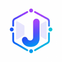
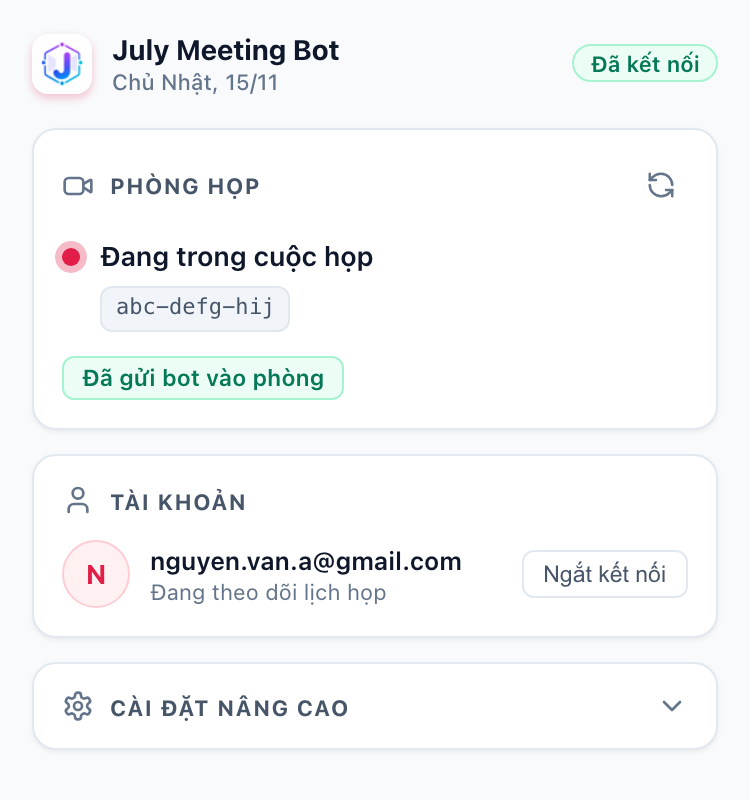
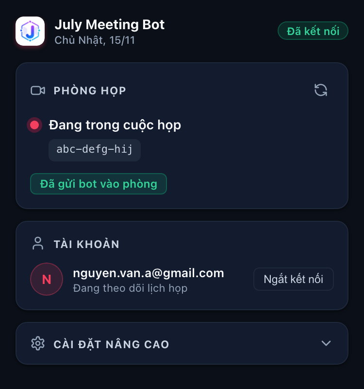
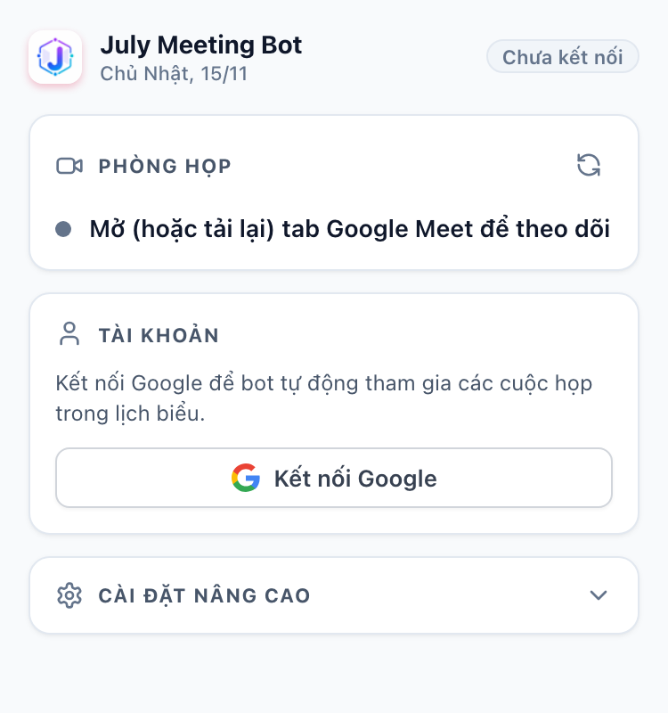
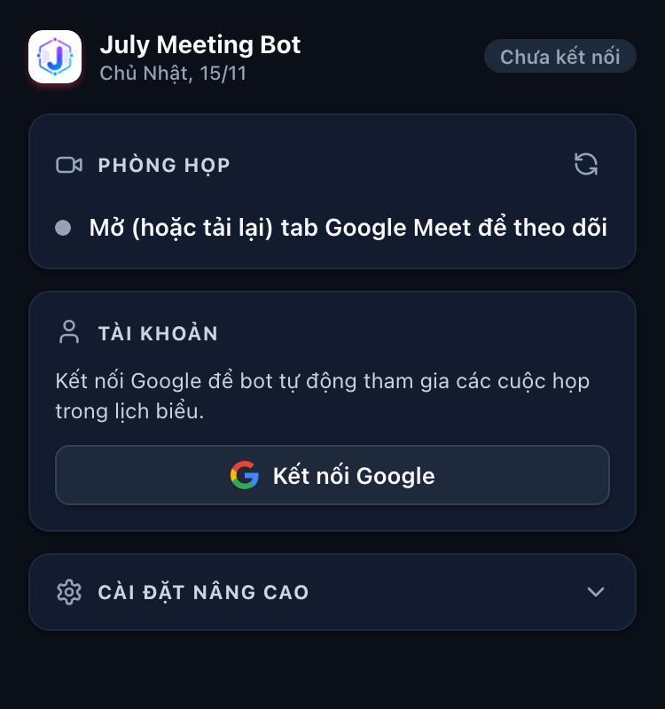
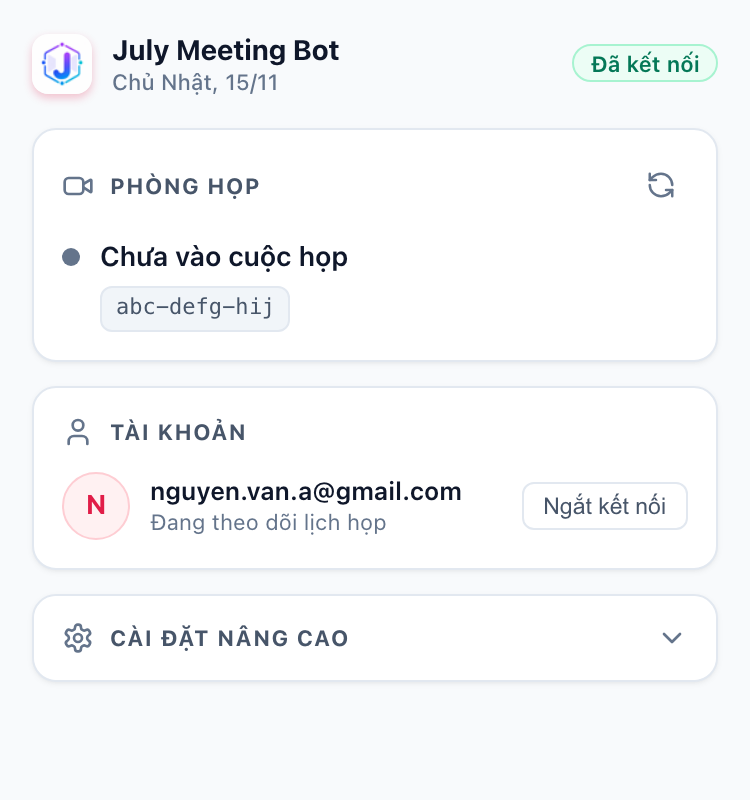
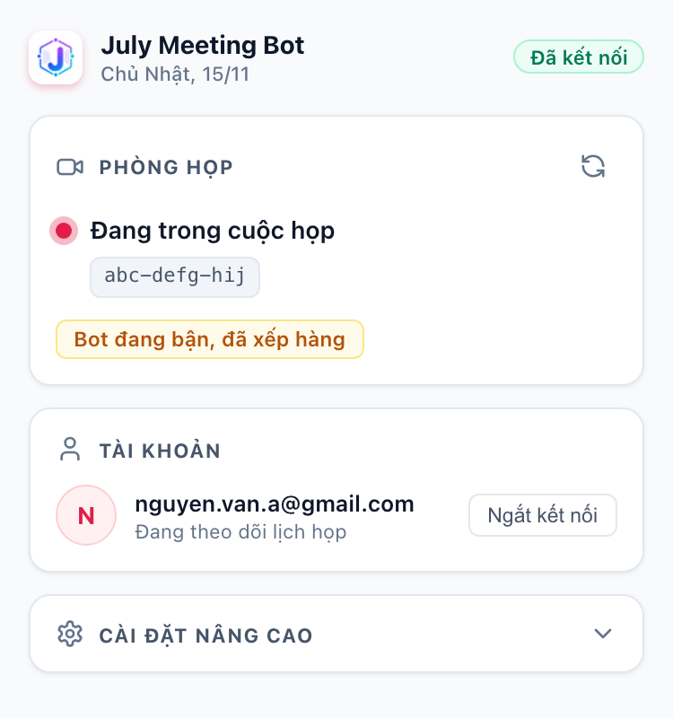
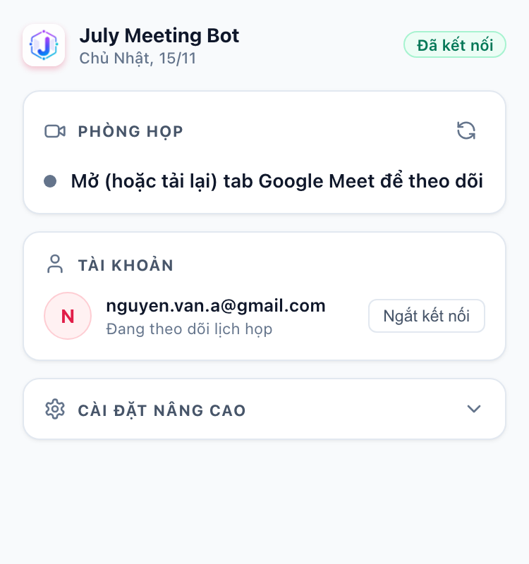
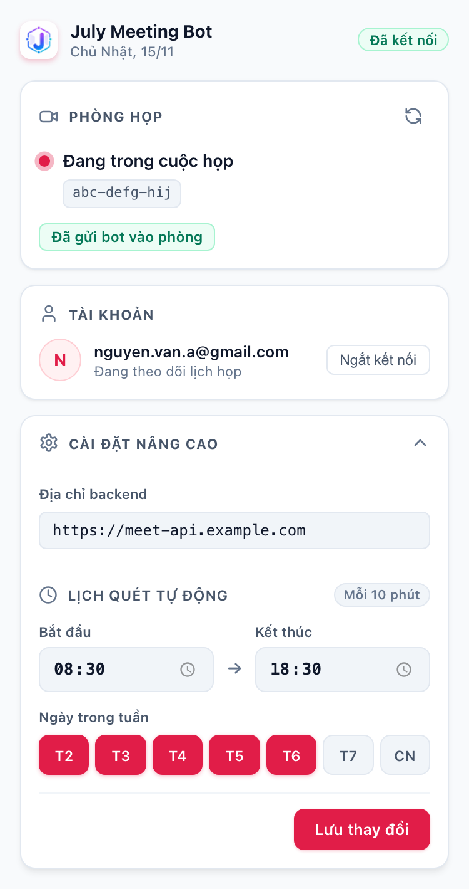
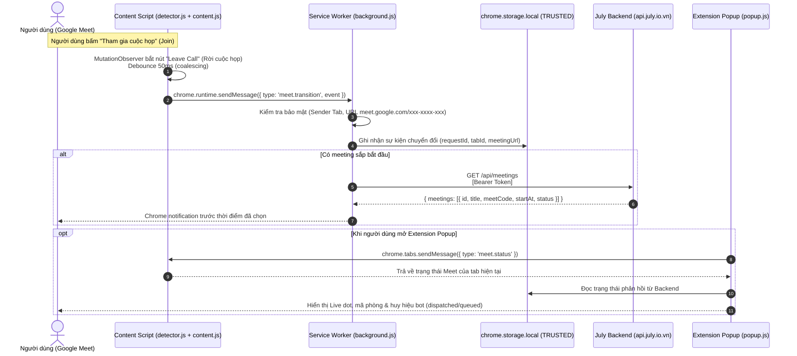

# July Meeting Bot (Chrome Extension)

<p align="center">
  
</p>

<p align="center">
  <strong>Trợ lý AI tự động điều phối Bot tham gia và ghi chép Google Meet theo thời gian thực</strong>
</p>

<p align="center">
  <a href="#tính-năng-nổi-bật"></a>
  <a href="#yêu-cầu-hệ-thống--cài-đặt"></a>
  <a href="#kiểm-thử--chất-lượng-mã-nguồn"></a>
  <a href="#kiến-trúc--bảo-mật"></a>
  <a href="#kiến-trúc--bảo-mật"></a>
</p>

---

## 📖 Tổng quan (Overview)

**July Meeting Bot Extension** là tiện ích mở rộng chuẩn **Google Chrome Manifest V3** giúp kết nối người dùng với hệ thống điều phối bot cuộc họp ([meeting-scheduler](https://api.july.io.vn)).

Tiện ích hoạt động hoàn toàn tự động trong nền:
1. **Nhắc lịch biểu (Calendar Reminders):** Đọc các meeting đã đồng bộ từ backend và hiện thông báo Chrome trước thời điểm bắt đầu theo cấu hình 1–10 phút.
2. **Ghi âm cục bộ (Local Recording):** Khi bạn tham gia Google Meet, bấm icon July hoặc nút nổi để ghi âm và lưu bản ghi ngay trên máy.

---

## 📸 Giao diện ứng dụng (Screenshots)

Giao diện tiện ích được thiết kế theo phong cách **Modern Enterprise SaaS** (lấy cảm hứng từ Linear & Notion), tự động tương thích hoàn hảo cả hai giao diện **Sáng (Light Mode)** và **Tối (Dark Mode)** theo thiết lập hệ điều hành (`prefers-color-scheme`).

### 1. Trạng thái trong cuộc họp (In-Call Active) & Chưa kết nối

| Giao diện Sáng (Light Mode) | Giao diện Tối (Dark Mode) |
| :---: | :---: |
|  |  |
| **Đang họp:** Nhận diện mã phòng họp, đèn tín hiệu Live phát sáng, hiển thị trạng thái bot đã vào phòng. | **Đang họp (Dark):** Chế độ nền tối dịu mắt, độ tương phản cao, tối ưu khi làm việc ban đêm. |
|  |  |
| **Chưa kết nối:** Hỗ trợ đăng nhập trực tiếp bằng Google OAuth hoặc Tài khoản Dashboard có sẵn. | **Chưa kết nối (Dark):** Thẻ cấu hình tài khoản trực quan và tinh gọn. |

---

### 2. Các trạng thái phòng họp & Cài đặt nâng cao

| Trạng thái phòng chờ (Pre-join) | Trạng thái Bot xếp hàng (Queued) |
| :---: | :---: |
|  |  |
| **Chưa vào cuộc họp:** Đang ở tab Google Meet nhưng người dùng chưa bấm tham gia (ở màn hình chờ). | **Hàng đợi:** Hệ thống ghi nhận phòng họp và xếp hàng điều phối bot khi tài nguyên sẵn sàng. |

| Không ở tab Google Meet | Cài đặt nâng cao & Lịch quét tự động |
| :---: | :---: |
|  |  |
| **Nhắc nhở mở tab Meet:** Tiện ích gợi ý mở hoặc tải lại tab Google Meet để bắt đầu theo dõi. | **Tùy chỉnh linh hoạt:** Thay đổi backend URL, cấu hình khung giờ quét và chọn các ngày trong tuần. |

---

## ✨ Tính năng nổi bật (Key Features)

- ⚡ **Zero-click In-Call Detection:** Tự động phát hiện khi bạn vào phòng họp Google Meet mà không cần bấm thêm bất cứ nút nào.
- 🔔 **Thông báo meeting sắp bắt đầu:** Service worker gọi `GET /api/meetings` mỗi phút và báo một lần cho mỗi meeting đã lên lịch.
- 🎙️ **Ghi âm cuộc họp:** Bấm icon July một lần để ghi/dừng; card nổi trong Meet có Ghi âm / Dừng để tiếp tục điều khiển ngay trên cuộc họp. Thu tiếng tab + micro thành một file WebM/Opus, lưu từng đoạn trong IndexedDB của extension. Có trang bản ghi để tải về và xóa file.
- 🔐 **Bảo mật tuyệt đối - Nguyên tắc đặc quyền tối thiểu (Least Privilege):**
  - Ghi âm bắt đầu sau khi người dùng gọi extension qua icon/phím tắt. Cần cấp quyền micro một lần trên trang riêng của July. Không sử dụng webcam.
  - `tabCapture` chỉ lấy audio của tab Meet, không gọi `getDisplayMedia`, không mở hộp chọn màn hình/cửa sổ và không thu video. Chrome vẫn có thể hiển thị chỉ báo tab đang được thu âm.
  - **Không** đòi quyền đọc lịch sử hay toàn bộ website (`no <all_urls>`, không cần quyền `tabs`).
  - Token API được lưu trong `chrome.storage.local` với cấu hình bảo mật `TRUSTED_CONTEXTS` (chỉ Service Worker và Popup mở rộng mới đọc được, Content Script trên trang Meet tuyệt đối không thể can thiệp).
- 🔄 **Xác thực linh hoạt (Dual Auth Flows):**
  - **Google OAuth:** Đăng nhập một chạm qua luồng chuẩn `chrome.identity.launchWebAuthFlow`.
  - **Dashboard Session:** Đăng nhập thông qua phiên làm việc đã có trên web dashboard.
  - **Mở Dashboard một chạm:** Nút *Mở dashboard* sử dụng liên kết dùng 1 lần (one-time auth code), tự động ngắt kết nối an toàn khi phiên làm việc hết hạn (401).
- ⏰ **Đồng bộ lịch quét tự động (Scan Schedule):** Tùy chỉnh khung giờ quét (mặc định: `08:30 - 18:30`, `Thứ 2 - Thứ 6`). Dữ liệu được lưu trữ trên `chrome.storage.sync` (đồng bộ giữa các máy tính của người dùng) và tự động đẩy lên máy chủ backend (`PUT /api/settings`).
- 🚀 **Zero-build Architecture:** Viết hoàn toàn bằng Modern JavaScript (ES Modules) và CSS native. Không cần cài đặt `npm`, không cần bước biên dịch Webpack/Vite hay đóng gói phức tạp — tải về là chạy được ngay lập tức.

---

## 🏗️ Kiến trúc & Luồng hoạt động (Architecture & Data Flow)

Dưới đây là sơ đồ tương tác giữa **Google Meet Tab**, **Extension Service Worker**, **Popup UI** và **Backend Scheduler**:



---

## 🔍 Cơ chế nhận diện cuộc họp (Detection Boundaries & Deep-Dive)

Google Meet liên tục cập nhật giao diện mà không có API công khai cho DOM. Tiện ích sử dụng cơ chế phát hiện chuyên sâu với độ chính xác cao:

1. **Heuristic nhận diện nút kết thúc cuộc gọi (Leave Call Button):**
   - Nút kết thúc cuộc gọi hợp lệ được xác định khi hiển thị trên màn hình (`visible`, không bị ẩn hoặc disabled) nằm trong vùng điều khiển cuộc họp.
   - Hỗ trợ đa ngôn ngữ nhãn nút: Tiếng Việt (*"Rời cuộc gọi"*, *"Rời khỏi cuộc gọi"*, *"Rời cuộc họp"*), Tiếng Anh (*"Leave call"*, *"Leave meeting"*).
   - Fallback biểu tượng: Nhận diện biểu tượng Material Icon / Google Symbol mang giá trị `call_end`.
   - Các màn hình chờ (Pre-join/Lobby) hoặc phòng duyệt không chứa tín hiệu này, loại bỏ hoàn toàn cảnh báo giả.

2. **MutationObserver tối ưu hóa hiệu năng (Zero-Lag DOM Monitoring):**
   - Meet hiển thị thanh điều khiển ngang hàng với thẻ `<main>`. Extension lắng nghe toàn bộ body nhưng áp dụng **bộ lọc thuộc tính nghiêm ngặt** (`attributeFilter`: `aria-label`, `disabled`, `hidden`, `class`, `data-google-symbol`).
   - Các thay đổi danh sách người tham gia, tin nhắn chat liên tục sẽ bị bỏ qua, không gây tốn CPU.
   - Gom cụm đột biến DOM với **50ms one-shot timeout** (không dùng `setInterval` định kỳ), đảm bảo phản hồi tức thì mà không lãng phí tài nguyên.
   - Theo dõi chuỗi thẻ cha (Ancestor Chain) để phát hiện kịp thời khi Meet thay thế toàn bộ cây DOM gốc.

3. **Vòng đời trang & BFCache (Back/Forward Cache):**
   - Sự kiện `pagehide`: Hủy toàn bộ observers và timers đang chờ để ngăn chặn rò rỉ bộ nhớ.
   - Sự kiện `pageshow` (với `persisted = true`): Tự động kích hoạt lại cơ chế theo dõi nếu trang được mở lại từ BFCache.

4. **Chuẩn hóa URL cuộc họp (Room Normalization):**
   - Chỉ chấp nhận các đường dẫn Google Meet HTTPS chuẩn dạng: `https://meet.google.com/xxx-xxxx-xxx` (loại bỏ query params và hash fragment).

---

## 🚀 Hướng dẫn cài đặt & Sử dụng (Installation & Usage)

### Yêu cầu hệ thống
- Trình duyệt **Google Chrome phiên bản 116** trở lên (hoặc các trình duyệt nhân Chromium tương thích hỗ trợ offscreen/tabCapture).
- Không cần cài đặt Node.js hay npm nếu chỉ sử dụng tiện ích (chỉ cần khi chạy bộ kiểm thử).

### Các bước cài đặt (Load unpacked)

1. **Tải mã nguồn về máy:**
   ```bash
   git clone https://github.com/your-username/meeting-extension.git
   cd meeting-extension
   ```

2. **Cài đặt vào Chrome:**
   - Mở trình duyệt Chrome và truy cập đường dẫn: `chrome://extensions/`
   - Bật công tắc **Chế độ dành cho nhà phát triển (Developer mode)** ở góc trên bên phải.
   - Bấm vào nút **Tải tiện ích đã giải nén (Load unpacked)** ở góc trên bên trái.
   - Chọn thư mục `meeting-extension` trên máy tính của bạn.

3. **Cấu hình tiện ích:**
   - Sau khi cài đặt, sao chép **ID của tiện ích** (ví dụ: `abcdefghijklmnop...`).
   - Điền ID này vào cấu hình danh sách `EXTENSION_IDS` trên hệ thống máy chủ `meeting-scheduler` của bạn.
   - Mở **Cài đặt July** từ card Meet hoặc mục **Tùy chọn** trong menu chuột phải của icon July:
     - Nhấp **Kết nối Google** (hoặc **Kết nối bằng tài khoản dashboard**).

4. **Sử dụng:**
   - Truy cập vào bất kỳ cuộc họp Google Meet nào. Tiện ích sẽ nhận diện phòng và cho phép bắt đầu ghi âm bằng icon toolbar hoặc float button.

### Ghi âm cuộc họp (v0.4.2)

1. Reload extension trong `chrome://extensions`, rồi tải lại tab Meet đã mở.
2. Tham gia phòng họp. Card nổi ở góc dưới bên phải sẽ nhắc cách bắt đầu. Ghim icon July trên thanh công cụ để dễ tìm.
3. Bấm **icon July** một lần để bắt đầu ghi ngay, không có bước mở popup rồi chọn Ghi âm. Với tab Meet mới, thao tác này đồng thời cấp quyền thu tab cho extension theo yêu cầu Chrome. Sau đó nút **Ghi âm** trên float cũng bắt đầu được và có thể dùng lại sau khi dừng. Float hiển thị hướng dẫn lần đầu; nếu chưa gọi extension cho tab, bấm float sẽ nhắc dùng icon và không mở cửa sổ micro. Hoặc dùng `Alt+Shift+R` (Mac: Option+Shift+R); card hiển thị phím tắt thực tế Chrome đã gán.
4. Lần đầu cần quyền micro, July mở **cửa sổ popup nhỏ** (460×420), không mở tab cấu hình lớn. Chọn **Cho phép** trong thông báo Chrome: July tự bắt đầu ghi cuộc họp đang chờ, đóng cửa sổ quyền và trở lại Meet. Nếu từ chối, July hiện lỗi và nút thử lại. Không có hộp chọn chia sẻ màn hình.
5. Bấm lại **icon July** hoặc **Dừng ghi âm** trên float để lưu. Float cũng có **Ghi âm** để bắt đầu bản tiếp theo. Extension còn dừng khi tab đóng/tải lại/chuyển trang, nguồn thu kết thúc hoặc không còn nút rời cuộc họp khoảng 6 giây; chỉ ẩn thanh điều khiển không làm dừng ghi.
6. Mở **Bản ghi trên máy** từ card để tải file theo tên cuộc họp + thời gian. Tài khoản/lịch quét vẫn có trong giao diện Cài đặt July; liên kết **Cài đặt** trên card mở giao diện đó trên trang riêng khi cần.

Micro được thu riêng, **không đi theo nút mute của Meet**. Để kết thúc thu micro, bấm Dừng ghi âm. Nên dùng tai nghe để tránh tiếng loa lọt lại vào micro.

Bộ ghi nằm trong offscreen document của extension, tiếp tục hoạt động khi popup đóng hoặc service worker khởi động lại. Mỗi lần chỉ ghi một tab. Reload/đóng/chuyển trang Meet sẽ yêu cầu bộ ghi dừng và lưu; nếu trình duyệt bị ngắt đột ngột, các đoạn đã xác nhận vẫn được giữ nhưng phần đuôi có thể mất và file được đánh dấu gián đoạn. Bản ghi cũ từ v0.3.0 vẫn đọc/tải được. File local thuộc profile trình duyệt này, không đồng bộ qua tài khoản; gỡ extension hoặc xóa dữ liệu extension sẽ mất các file đó.

**Upload đang chờ contract API signed R2** (Bead `meet-ext-736`). Bản ghi hoàn tất hiện “Chờ kết nối upload”, chưa gửi lên server nào. `signed-upload.js` đã có primitive PUT bằng signed HTTPS URL, không mang cookie/token backend và không theo redirect. Endpoint xin URL, payload, quyền host/CORS, giới hạn file và bước xác nhận hoàn tất sẽ được nối khi có contract; không sử dụng gateway của extension mẫu.

---

## 🧪 Kiểm thử & Chất lượng mã nguồn (Testing & QA)

Dự án áp dụng phương pháp phát triển hướng kiểm thử (**Test-Driven Development - TDD**). Bộ kiểm thử bao gồm các kịch bản kiểm tra DOM giả lập (Playwright DOM Fixtures) và kiểm thử logic tích hợp của Node.js:

```bash
# 1. Cài đặt các gói phụ thuộc dùng cho kiểm thử
npm ci

# 2. Chạy toàn bộ bài kiểm thử (cần Google Chrome cài sẵn)
npm test

# 3. Kiểm tra tính hợp lệ của tệp manifest.json
npm run validate
```

Kiểm thử native đầy đủ cần Chrome for Testing hiện tại hỗ trợ nạp extension bằng CLI và CDP Extensions. Bài này dùng profile tạm, tab âm thanh tổng hợp và micro giả; không dùng tài khoản Google hay micro thật. `npm test` mặc định bỏ qua bài native nếu chưa chỉ định executable:

```bash
CAPTURE_BROWSER_EXECUTABLE="/path/to/Chrome for Testing executable" node --test tests/recording-integration.test.mjs
```

Bài native dùng profile mới chưa được cấp quyền micro: float trước khi gọi extension bị chặn và không mở trang quyền; một lần bấm icon mở cửa sổ micro nhỏ tự đóng trong khi offscreen vẫn ghi. Sau đó kiểm tra float Dừng → Ghi âm lại mà không cần thêm icon/cửa sổ, icon Dừng → ghi lại mà không mở cửa sổ, tải và giải mã WebM. Không dùng `--use-fake-ui-for-media-stream`: cờ đó can thiệp cả tab capture; harness chỉ tự chấp nhận camera/micro giả trong profile thử. Chrome for Testing 158 hỗ trợ bài này; Chromium kiểm thử cũ có thể thiếu API bảo vệ token `storage.local.setAccessLevel` dù hỗ trợ offscreen.

### Các kịch bản kiểm thử chính (Test Coverage)

- **DOM Fixtures:** Mô phỏng phòng chờ Meet, màn hình trước tham gia, nút điều khiển bị ẩn/vô hiệu hóa, thay đổi ngôn ngữ Anh/Việt, fallback biểu tượng `call_end`, người dùng rời và vào lại cuộc họp, chuyển tab và dọn dẹp bộ nhớ.
- **Service Worker & State Continuity:** Đảm bảo duy trì đúng `requestId` cho cùng một sự kiện, tạo mới ID khi đổi phòng họp, cơ chế thử lại (exponential retry) khi lưu trữ cục bộ gặp sự cố.
- **Backend API & Authentication:** Kiểm tra quy trình nhận token OAuth qua fragment URL, gửi Bearer token, tự động ngắt kết nối an toàn khi gặp mã lỗi 401, mở Dashboard bằng liên kết một lần.
- **Schedule Validation:** Kiểm tra chuẩn hóa khung giờ, chặn khoảng thời gian không hợp lệ, lưu trữ danh sách ngày trong tuần.
- **Manifest Scope:** Xác thực quyền hạn tối thiểu, không có quyền thừa hoặc không an toàn.
- **Recording:** Ràng buộc tab audio-only, khôi phục tiếng tab, quyền micro, mất nguồn giữa lúc cấp quyền/lưu, thứ tự chunk cuối, lỗi lưu trữ, tự dừng, tải/xóa file local và signed PUT. Controller/router kiểm tra nguồn gửi và phục hồi trạng thái từ offscreen sau khi worker khởi động lại. Cuộc họp Meet đăng nhập thật và gửi R2 thật cần kiểm tra riêng.

---

## 📁 Cấu trúc thư mục (Project Structure)

```text
meeting-extension/
├── manifest.json         # Manifest V3 cấu hình quyền hạn, content scripts, background worker
├── background.js         # Service Worker: xử lý thông điệp, hàng đợi lưu trữ, điều phối bot
├── detector.js           # Bộ dò tìm trạng thái Google Meet (MutationObserver, DOM heuristic)
├── content.js            # Content script tích hợp detector với vòng đời trang Meet (BFCache, retries)
├── backend.js            # Module giao tiếp Backend API, luồng xác thực Google / Dashboard
├── schedule.js           # Logic xử lý và kiểm tra tính hợp lệ của lịch quét tự động
├── events.js             # Chuẩn hóa cấu trúc sự kiện chuyển đổi trạng thái cuộc họp
├── recorder.js           # Thu tiếng tab + micro, tạo WebM và gửi các đoạn âm thanh theo thứ tự
├── offscreen.html        # Trang nền giữ media streams (offscreen.js)
├── recording-controller.js # Điều phối tabCapture, trạng thái phiên và vòng đời tab
├── microphone.html       # Cấp quyền micro một lần (microphone.js)
├── recording-ui.js       # Bảng ghi âm nổi trong Meet (Shadow DOM)
├── recording-service.js  # Kiểm tra nguồn gửi lệnh start/status/stop và state
├── recording-store.js    # IndexedDB của extension: metadata và audio chunks
├── recordings.html       # Trang quản lý file local (recordings.js / recordings.css)
├── signed-upload.js      # Signed HTTPS PUT; chờ contract API để nối luồng upload
├── popup.html            # Giao diện người dùng Popup (Modern Enterprise Card UI)
├── popup.css             # Định kiểu giao diện, biến màu CSS Tokens, hỗ trợ Light & Dark theme
├── popup.js              # Logic hiển thị trạng thái và tương tác trên popup
├── icons/                # Bộ biểu tượng ứng dụng ở các kích thước chuẩn (16, 32, 48, 128px)
├── docs/                 # Tài liệu thiết kế, kế hoạch phát triển và bộ ảnh chụp màn hình
│   └── screenshots/      # Toàn bộ ảnh chụp màn hình minh họa giao diện (Light & Dark)
└── tests/                # Bộ bài kiểm thử tự động (Playwright fixtures & Node test runner)
    ├── backend.test.mjs
    ├── background-incall.test.mjs
    ├── detector.test.mjs
    ├── events.test.mjs
    ├── manifest.test.mjs
    ├── popup-dom.test.mjs
    └── schedule.test.mjs
```

---

## 🔒 Cam kết bảo mật & Quyền riêng tư (Security & Privacy)

| Quyền (Permission) | Phạm vi sử dụng | Lý do & Cam kết bảo mật |
| :--- | :--- | :--- |
| `storage` | Lưu trữ cục bộ & đồng bộ | Lưu cài đặt lịch quét (`storage.sync`) và trạng thái phiên tạm thời (`storage.local`). Token truy cập được cô lập trong `TRUSTED_CONTEXTS`. |
| `identity` | Xác thực đăng nhập | Sử dụng `launchWebAuthFlow` an toàn để đăng nhập OAuth2 mà không cần lưu mật khẩu người dùng trong tiện ích. |
| `activeTab`, `tabCapture` | Tab được người dùng gọi extension | Thu audio tab sau thao tác qua icon/phím tắt; không thu video/màn hình. |
| `offscreen` | Trang nền của extension | Giữ media streams, trộn tab+micro, phát lại tiếng tab và lưu file khi popup đóng/worker nghỉ. |
| `meet.google.com/*` | Chỉ định trên tab Meet | Chỉ chạy Content Script trên miền `meet.google.com`. Tuyệt đối không can thiệp hay đọc bất kỳ trang web nào khác. |

---

## 📄 Bản quyền (License)

Dự án phát triển nội bộ cho hệ sinh thái **July** ([api.july.io.vn](https://api.july.io.vn)). Mọi quyền được bảo lưu.
